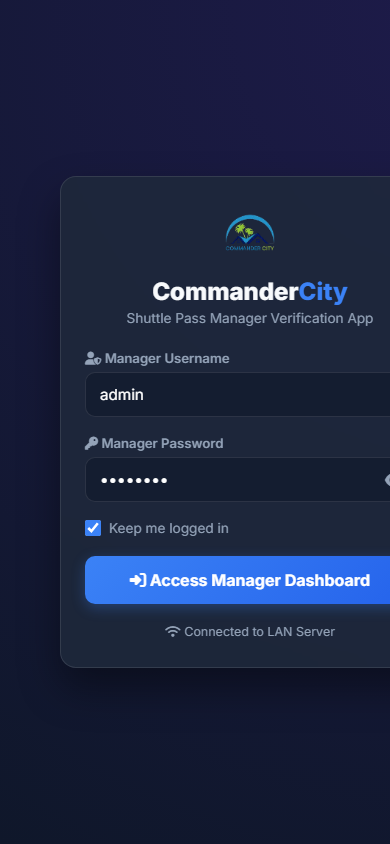

<div align="center">

# Shuttle Pass Renewal System

**A full-stack web application built for Commander City Housing Society to digitize monthly shuttle pass management, replace manual Excel tracking, and enable remote manager verification over LAN.**

[](https://nodejs.org)
[](https://developer.mozilla.org/en-US/docs/Web/JavaScript)
[](https://web.dev/pwa/)
[](https://sheets.google.com)

</div>

---

## Client Overview

| | |
|---|---|
| **Client** | Commander City Housing Society |
| **Industry** | Residential Community Management |
| **Role** | Full-Stack Developer (End-to-End Delivery) |
| **Status** | Deployed on local network |

---

## The Problem

Commander City manages monthly shuttle passes for hundreds of residents. Their existing workflow was entirely **manual and paper-based**:

- Passes tracked in Excel spreadsheets with no central system
- Serial numbers assigned manually, causing duplicates and confusion
- Manager had to physically inspect each pass card before approving it
- No way to verify passes remotely — manager had to be at the desk
- Monthly renewals required recreating every pass from scratch
- No audit trail for payments or pass issuance history
- No integration with their existing Google Sheets tracking

The result was **wasted hours every month**, frequent data entry errors, and no reliable record of who held a valid pass.

---

## The Solution

A **complete web-based shuttle pass management system** that runs entirely on the client's local network — no cloud database, no recurring costs, no data leaving their premises.

---

## Screenshots

### Desktop Dashboard

The main dashboard displays all pass cards in a responsive grid with 12 distinct monthly color themes. Each card shows the resident's name, CNIC, house number, serial badge, photo, and validity dates. Includes real-time sync status, search, filtering, and batch operations.


<br>

### Manager Mobile Verification App

A companion PWA served over LAN. The manager scans a QR code on their phone to access a real-time queue of pending passes. Each card shows the resident photo, details, and amount — with approve/hold buttons for instant verification. Approvals push to the desktop dashboard in real-time via Server-Sent Events.

<div align="center">
  
  <br>
  <em>Manager Mobile App — Login screen with LAN connection status</em>
</div>

<br>

### Monthly Pass Card Design

Pass cards are designed to the **standard CNIC physical dimension** (85.6mm × 54mm) for direct printing on card stock. Each month has a unique color theme (12 total), with member photo, serial badge, house number, and validity period — ready for batch printing.

---

## Key Features

| Module | Description |
|--------|-------------|
| **Monthly Pass Dashboard** | Card-based view with 12 monthly color themes, search, filtering, and batch operations |
| **Members Directory** | Full resident profiles with photo, CNIC, house/plot, contact — importable from Excel |
| **One-Click Bulk Renewal** | Renews all active passes to next month with auto-generated sequential serial numbers |
| **Manager Mobile Verification** | PWA companion app — QR-paired, approve/reject passes from phone over LAN |
| **Google Sheets Auto-Sync** | Verified passes sync to Google Sheets via Apps Script webhook |
| **Print-Ready Pass Cards** | CNIC-standard cards (85.6mm × 54mm) with member photo, serial badge, monthly theme |
| **Auto CSV Registers** | Monthly Excel-ready registers with totals, generated in background |
| **Real-Time Desktop Sync** | SSE pushes manager approvals from phone to all open desktop screens instantly |

---

## Architecture

```
┌───────────────────────────┐      HTTP / JSON       ┌──────────────────────────────┐
│  Desktop Dashboard        │ ─────────────────────▶ │  Node.js Host Server         │
│  (index.html)             │ ◀───────────────────── │  server.js :3000             │
│  • Monthly Passes         │   /api/sync            │  • Serves static files       │
│  • Members Directory      │   /api/system-state    │  • Writes JSON to data/      │
│  • Bulk Renewal           │   /api/events (SSE)    │  • Auto CSV registers        │
│  • History & Reporting    │                        │  • Google Sheets webhook     │
└───────────────────────────┘                        └──────────────┬───────────────┘
        ▲                                                          │
        │ IndexedDB (offline cache)                     ┌───────────▼───────────────┐
┌───────────────────────┐    LAN (same Wi-Fi)           │  Manager Mobile App       │
│  Manager Mobile App   │ ─────────────────────────▶   │  • Login + pending queue   │
│  (mobile.html / PWA)  │   /api/login                 │  • Approve / Hold / Bulk   │
│  PWA installable      │   /api/pending-passes        │  • Real-time via SSE       │
└───────────────────────┘   /api/approve-pass          └───────────────────────────┘
```

**Design Decisions:**
- **Zero npm dependencies** — server uses only Node.js built-in modules (`http`, `fs`, `path`, `os`)
- **Browser-first data** — IndexedDB provides instant UI with background sync to disk
- **Server wins on verification** — sync guard prevents stale tabs from overwriting manager approvals
- **Local-only by design** — no data leaves the network unless Google Sheets sync is enabled

---

## Tech Stack

| Layer | Technology |
|-------|-----------|
| Frontend | Vanilla JavaScript, CSS3, Font Awesome 6, Inter font |
| Backend | Node.js (zero dependencies — stdlib only) |
| Data Layer | Browser IndexedDB + local JSON files |
| Excel Parsing | SheetJS (xlsx) |
| QR Code | QRCode.js (LAN pairing) |
| Real-Time | Server-Sent Events (SSE) |
| Mobile | PWA with `manifest.json` |
| Cloud Sync | Google Apps Script → Google Sheets |

---

## Key Features in Detail

### Smart Serial Number Management
Passes use auto-incrementing serial numbers scoped per month (`01`, `02`, `03`...), ensuring no duplicates. Supports both auto-assignment and manual serial selection.

### Fee Schedule System
Configurable fee rules that change over time — the system applies the correct rate based on pass month/year:

```javascript
// Fee increase from September 2026
{ startYear: 2026, startMonth: 9, fullAmount: 8000, halfAmount: 4000 }
{ startYear: 2026, startMonth: 1, fullAmount: 6000, halfAmount: 3000 }
```

### Manager Verification Workflow
Every new pass starts as `verified: false`. The manager opens the mobile app, sees a live queue with member photos and details, and approves or holds each one. The desktop updates in real-time via SSE — no refresh needed.

### Data Safety
- Auto-versioned snapshots every 5 minutes (with force-sync button)
- Sync guard prevents stale browser tabs from overwriting server-verified approvals
- Full audit trail with `verifiedBy`, `verifiedAt` timestamps

---

## Getting Started

### Quick Start (Windows)
1. Place the folder anywhere
2. Double-click `START.bat`
3. App opens at `http://localhost:3000`

### Manual Start
```bash
node server.js
# → http://localhost:3000
# → Manager Mobile: http://YOUR_LAN_IP:3000/mobile.html
```

### Default Manager Login

| Field | Value |
|-------|-------|
| Username | `admin` |
| Password | `admin123` |

> Change via the mobile app's password screen or by creating `data/manager_config.json`.

---

## Project Structure

```
shuttle-pass-system/
├── index.html                 # Desktop main app
├── mobile.html                # Manager Mobile Verification App (PWA)
├── server.js                  # Node.js server (API + static + CSV sync)
├── manifest.json              # PWA manifest for mobile install
├── START.bat                  # One-click Windows launcher
├── screenshots/               # Application screenshots for documentation
├── css/
│   ├── styles.css             # Desktop UI (dark theme, 12 card designs)
│   └── mobile.css             # Mobile app styles
├── js/
│   ├── db.js                  # IndexedDB layer, sync, SSE listener
│   ├── app.js                 # Desktop app controller
│   └── mobile.js              # Mobile verification controller
└── scripts/
    └── google_apps_script.js  # Google Sheets Apps Script (paste into Sheets)
```

---

## API Endpoints

| Method | Endpoint | Description |
|--------|----------|-------------|
| `GET` | `/api/system-state` | Full system state |
| `GET` | `/api/system-info` | Server info + LAN IPs |
| `GET` | `/api/events` | SSE stream (real-time updates) |
| `POST` | `/api/login` | Manager authentication |
| `POST` | `/api/change-manager-password` | Password change |
| `GET` | `/api/pending-passes` | Passes awaiting verification |
| `POST` | `/api/approve-pass` | Approve a single pass |
| `POST` | `/api/reject-pass` | Hold/reject a pass |
| `POST` | `/api/verify-all` | Bulk-verify all pending |
| `POST` | `/api/sync` | Save/merge state |
| `GET/POST` | `/api/google-config` | Google Sheets webhook config |
| `POST` | `/api/test-google-sync` | Test webhook connection |

---

## Impact

- **Eliminated manual Excel tracking** — all pass data lives in one system
- **Reduced monthly renewal time** from hours to a single click
- **Enabled remote verification** — manager approves passes from phone on-site
- **Zero data loss** — auto-versioned snapshots and sync guard protect against overwrites
- **Seamless Google Sheets integration** — verified data flows to existing workflow
- **No recurring costs** — runs on local hardware, zero cloud dependencies

---

## Privacy & Data

This repository **excludes all customer data**. The `.gitignore` blocks `data/`, photo directories, imported member files, and business documents. Only application source code and documentation screenshots are published.

At runtime, all data stays on the client's local machine and network.
